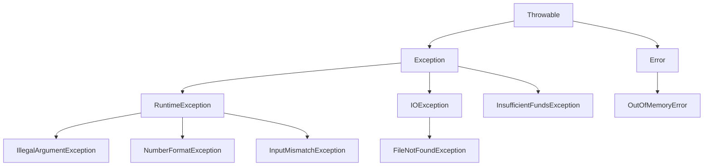

# Q1: ATM withdrawal failure handling

## Shared

Failure points and classification:
- Non-numeric input -> NumberFormatException or InputMismatchException; unchecked runtime exception.
- Negative amount -> IllegalArgumentException; unchecked runtime exception.
- Insufficient balance -> InsufficientFundsException (custom checked exception).
- Missing card file -> FileNotFoundException; checked exception.
- Error example -> OutOfMemoryError or StackOverflowError; Error (not an Exception).

Typical catch/finally structure:
- try: parse input, validate amount, check balance, try card lookup.
- catch: multi-catch for NumberFormatException | InputMismatchException, then IllegalArgumentException, then InsufficientFundsException, then FileNotFoundException.
- finally: always prints transaction attempt finished, ensuring cleanup or close hooks for output/logging.

## Student A

### Throwable hierarchy diagram


### Catch order justification
A broader catch such as `catch (Exception e)` must come after narrower checked/unchecked exceptions. Otherwise it will swallow the specific exceptions and the compiler will complain because the later handlers are unreachable. In Java, the most specific exceptions must be listed first.

### What finally guarantees here
`finally` runs whether the method succeeds, throws, or catches an exception. It is the last place to log the transaction attempt and perform cleanup like closing streams or resetting state.

## Student B

### Test inputs
| Input | Path triggered | Catch block hit | Finally executed |
|---|---|---|---|
| 250 | valid withdrawal | none (success) | yes |
| abc | non-numeric input | NumberFormatException / InputMismatchException | yes |
| -20 | negative amount | IllegalArgumentException | yes |
| 600 | insufficient funds | InsufficientFundsException | yes |
| missing-card.txt | missing card file | FileNotFoundException | yes |

### Uncaught exception stack trace explanation
`NumberFormatException` is thrown by `Double.parseDouble()` when the string is not numeric. The stack trace shows the call path from the parser to `AtmDemo.parseAmount()` to `AtmDemo.runCase()` and then to `main`. Each line identifies the frame, method name, file name, and line number. The top frame is the direct source of the failure.

### Compiler error for broad catch before narrow catch
```java
catch (Exception e) {
    ...
} catch (NumberFormatException e) {
    ...
}
```
This fails to compile because the more specific exception is unreachable after the broader `Exception` catch.

## Joint

Should the ATM use a single `catch (Exception e)`? Only if the system intentionally wants one broad fallback path for all application errors and does not need tailored recovery. It is convenient for logging, but it loses the specific recovery logic, error classification, and clean action plan for each type of failure. The code becomes harder to maintain and hides important problems.

## Alternative (no exceptions)
A no-exception design using `hasNextInt()` or a sentinel return code (`-1`) is simpler for tiny programs but forces the caller to check many conditions manually. It also makes the flow less readable because the same validation logic is repeated in multiple branches. Throwing an exception is often clearer for exceptional conditions, though the exception capture cost includes stack trace creation and causes more memory and time overhead.
