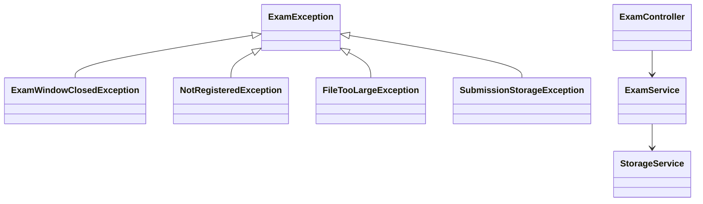

# Q2: Online exam portal, user-defined exceptions and propagation

## Shared

The checked hierarchy is built around `ExamException`.
- `ExamException` is checked because the controller should be forced to acknowledge submission failures.
- `ExamWindowClosedException` is checked because the UI must decide how to inform the student.
- `NotRegisteredException` is checked because the user should not be allowed to submit without registration.
- `FileTooLargeException` is checked because file size is a business rule that should be handled by the caller.
- `SubmissionStorageException` is checked because a filesystem error is not safe to ignore.

Propagation path: the controller catches a top-level `ExamException`, prints a user-friendly message, and rethrows it. The service layer throws domain exceptions, and the storage layer attaches the original `IOException` as the cause.

## Student A

### Class diagram


### Checked vs unchecked reasoning
Each exception represents a recoverable problem that the student or application must respond to. A checked exception forces the caller to either handle or propagate the mistake.

### Propagation path
`StorageService.store()` catches `IOException` and wraps it in `SubmissionStorageException("Could not store ...", e)`. The `ExamService` rethrows it, and the controller prints `Error: ...` before continuing or aborting the workflow. The message shown to the student is the user-facing text, while the stack trace keeps the technical cause.

### What the student sees
The student sees a concise UI message: `Error: Could not store answer02.pdf` with the cause preserved internally as `Disk quota exceeded`.

## Student B

### Test scenarios
| Exception | Scenario | Cause shown |
|---|---|---|
| `ExamWindowClosedException` | Submission after deadline | Deadline exceeded |
| `NotRegisteredException` | Student not enrolled | Registration problem |
| `FileTooLargeException` | File above size limit | Size check issue |
| `SubmissionStorageException` | Disk error or write failure | Root `IOException` |

### `getCause()` demonstration
The code writes:
```java
throw new SubmissionStorageException("Could not store answer02.pdf", new IOException("Disk quota exceeded"));
```
The cause chain is `SubmissionStorageException -> IOException("Disk quota exceeded")`.

### Full chained stack trace
```text
java.lang.Exception: Could not store answer02.pdf
    at ExamPortalDemo.main(ExamPortalDemo.java:...) 
Caused by: java.io.IOException: Disk quota exceeded
    at StorageService.store(StorageService.java:...) 
```
If the cause is not passed, then `e.getCause()` is null and calling `e.getCause().getMessage()` triggers a `NullPointerException`.

## Joint

`SubmissionStorageException` is preferred over letting `IOException` reach the UI because the UI should not know about low-level filesystem details. It preserves the business meaning (`Could not store answer02.pdf`) and the technical root cause (`Disk quota exceeded`) in a single, clear exception object.

## Alternative: unchecked exceptions
If exceptions are made unchecked by extending `RuntimeException`, the method signatures no longer need `throws` declarations and callers do not have to catch them. That makes code shorter but weakens the contract. The compiler cannot enforce error handling, so failures may be missed until runtime.

### Expected output
```text
Saved answer01.pdf
Error: Could not store answer02.pdf
Cause: Disk quota exceeded
```
If the `IOException` were not passed, then the `Cause` line would crash with `NullPointerException` because `e.getCause()` would be null.
