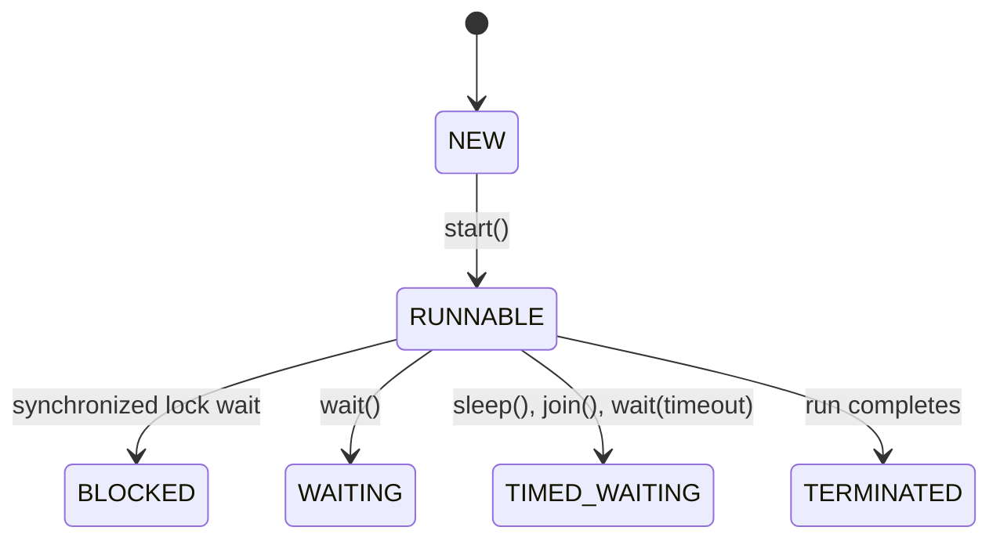

# Q4: Thread creation and life cycle (answer-script scanning)

## Shared

The program uses four scanner-station threads. Each thread is started with `start()`, sleeps briefly, records its finish order, and exits. The lifecycle states are NEW, RUNNABLE, BLOCKED, WAITING, TIMED_WAITING, and TERMINATED.

## Student A

### Thread vs Runnable
- `Thread` is a concrete class and is best when the task is a direct thread abstraction.
- `Runnable` is better when the task should be decoupled from the execution context or reused in other constructs.

### State diagram

### `run()` vs `start()`
Calling `run()` directly executes on the current thread, which in this demo is the main thread. Calling `start()` creates a new lifecycle and invokes the method on a distinct thread.

### `join()` effect
`join()` blocks the caller until the target thread finishes. That ensures the final summary is printed only after all scanner stations complete.

## Student B

### Finish-order table
The order varies because the scheduler decides when each thread runs. The observed finish order is a valid output and is not guaranteed to be identical across runs.

### Priority experiment
Thread priorities can influence scheduling but are not guaranteed. Operating systems may ignore them or combine them with other scheduling rules.

### Daemon thread
A daemon thread is terminated when the JVM shuts down. It is suitable for background activity; it does not block process shutdown.

## Joint

The output varies because different threads are scheduled in different orders. Correct programs must never assume a fixed ordering unless synchronization or explicit waiting is used.

## Alternative: ExecutorService
A fixed thread pool is usually easier to manage than manually creating threads. It reduces thread lifecycle overhead and supports future-based task handling.
