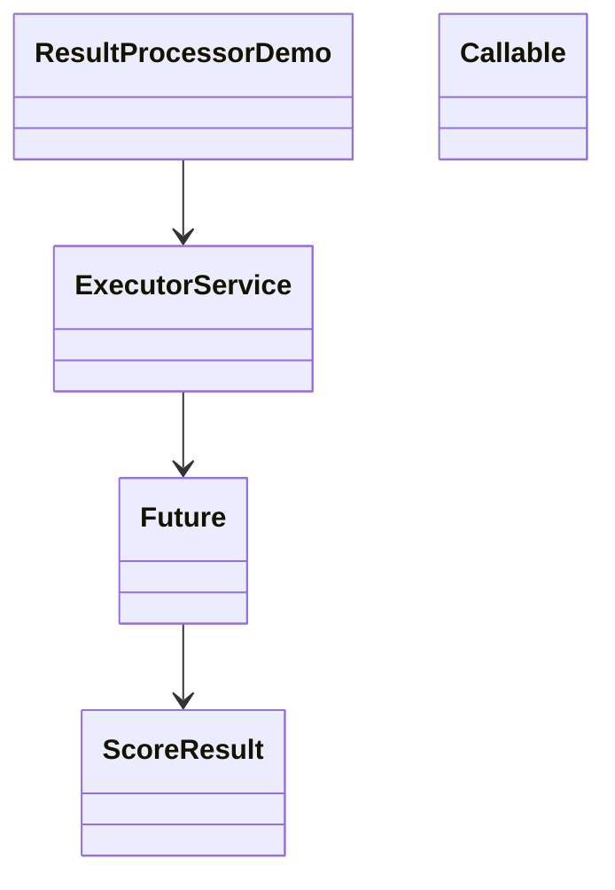

# Q7: Concurrent fault-tolerant result processor

## Shared

This exercise processes 1,000 generated score files using a fixed thread pool and a concurrent collector. Each task handles a single file and returns a result without letting one file failure stop the whole run.

Failure types handled:
- missing file
- invalid or corrupt content
- out-of-range score
- I/O failure

## Student A

### Design
The program uses `ExecutorService`, `Callable<Result>`, and `Future`. Results are accumulated in `ConcurrentHashMap` counters using `LongAdder` to ensure thread-safe updates without locking the entire process.

### Class diagram

### Failure handling
Each task catches exceptions inside `call()` and returns a failed result instead of throwing them back to the main thread. The main thread then consumes every `Future` and records the final summary.

## Student B

### Small validation set
A smaller validation run verifies that valid, invalid, and failed files reconcile to the total files processed. In the generated sample, the valid count is 901 and the failed count is 99, which demonstrates the fault-tolerant path.

### Thread-pool benchmark
The benchmark uses pools of 1, 2, 4, and 8 threads. More threads did not always help because the workload is dominated by file I/O and coordination overhead rather than CPU work.

## Joint

The recommended pool size depends on the file system and CPU. The design is correct because every future is consumed, the counters reconcile, and one failed task cannot stop the full run.

## Alternative analysis
`parallelStream()` is shorter but gives less explicit control over failure handling and thread count, while a thread-per-file approach risks exhausting native threads and memory when the file count is large.
